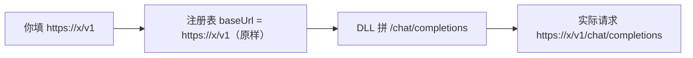

# ProPilotFix · ProPilot 一键永久修复工具

> **ProPilotFix** — Make ProPilot 9 (the AI assistant inside Proteus 9) work with **your own** OpenAI-compatible API. One-click permanent patch, Chinese UI, custom model, **chat-only, no proxy, no auto-start**.
>
> 仓库：https://github.com/nuoyafz/Proteus-ProteusAI-Unlock · 作者：nuoyafz

**搜索关键词**：Proteus 9 ProPilot 自定义 API · ProPilot 不能用自己的模型 · ProPilot 401 错误 · ProPilot 全英文 · ProPilot 连接失败 · ProPilot 中转站 · ProPilot Custom LLM · ProPilot OpenAI compatible · Proteus AI 助手 汉化。

让 Proteus 9 自带的 **ProPilot** AI 助手用你自己的 API 正常聊天：能连自定义接口 / 中转站、能改模型、界面全中文、主窗口标题写死为「ProPilotFix」。
**点一次就永久生效**：改完 DLL + 注册表，之后开机直接打开 Proteus 9 就能聊，不用启动任何工具、不用挂代理、不用设开机自启。

只解决「聊天」这一件事，不碰原理图、不碰 MCP、不常驻任何进程。

---

## 目录

- [下载](#下载)
- [适用版本](#适用版本)
- [三步使用](#三步使用)
- [一、原版到底出了什么问题](#一原版到底出了什么问题)
- [二、这个工具修了什么](#二这个工具修了什么)
- [三、为什么是「你填什么就是什么」](#三为什么是你填什么就是什么)
- [四、地址怎么填](#四地址怎么填)
- [五、常见问题与错误码](#五常见问题与错误码)
- [六、原理给爱折腾的人](#六原理给爱折腾的人)
- [七、从源码运行自己打包](#七从源码运行自己打包)
- [八、文件说明与还原](#八文件说明与还原)
- [九、免责声明](#九免责声明)

---

## 下载

| 文件 | 说明 |
| --- | --- |
| **[⬇ Releases · v2.0.0](https://github.com/nuoyafz/Proteus-ProteusAI-Unlock/releases/tag/v2.0.0)** | **推荐**。下载页面里的附件（文件名 `ProPilotFix.exe`） |
| [`release/ProPilotFix.exe`](release/ProPilotFix.exe) | 仓库内直链，约 9.9 MB。Windows 单文件 GUI，无需装 Python、无需安装 |
| `ProPilotFixGUI.py` + `ProPilotFix.py` | 源码，纯 Python 标准库，想自己改 / 自己打包用 |

> 两个 exe 内容完全一致（SHA256 `cc4d8f6f2301d13b3873ba7e514911cdf1b74519382c8bf8083cebf5a319a358`）。下载后放桌面、微信下载目录、U 盘都行，**别放进 `ProPilot.dll` 目录**。

---

## 适用版本

| 项 | 值 |
| --- | --- |
| 目标 | **Proteus 9 Professional** 自带的 ProPilot（9.2.45801.1） |
| 原版 DLL SHA256 | `35be5f09eca913947e512c2b3d6fb8803b7ad9e3c8d4a65c2399f946354f5414` |
| 系统 | Windows（注册表 + PE 补丁） |
| 其它版本 | 每条写入前会**逐字节校验原文**，对不上的条目自动跳过（不会写坏）；模型补丁若 `LEA` 指令不匹配也会跳过。所以版本不同一般不会崩，但汉化/模型可能不全 |

装的是别的 Proteus 版本：改 `ProPilotFix.py` 里的 `REG_PRODUCT` 一行即可适配注册表路径。

---

## 三步使用

1. **完全退出 Proteus 9**（不退出 DLL 被占用，且它退出时会把旧配置写回注册表）。
2. 双击 `ProPilotFix.exe` → 程序自动搜索 `ProPilot.dll`（卸载表 → 常见安装路径 → 全盘限时扫描）；找不到就点「浏览…」手动选 Proteus 安装目录下的 `BIN` 文件夹。
   界面右上角显示「● 非管理员」时，点一下「点此以管理员重启」（DLL 装在 `C:\Program Files` 下需要写权限）。
3. 在「② 接口」里填**你自己的** 3 项，然后按顺序点两个按钮：

   | 顺序 | 按钮 | 作用 |
   | --- | --- | --- |
   | 先 | `● 接口自检` | **只读**，不改任何文件。按真实拼法 GET 模型表 + POST 一句 `hi`，显示「聊天接口可用」再继续 |
   | 后 | `★ 一键永久修复` | 改 DLL（汉化 / 标题 / 模型 / 地址后缀）+ 原样写注册表，完成 |

   最后**重开 Proteus 9**，直接发消息就能聊。

> ⚠️ **不要点 ProPilot 设置里的「测试连接」按钮**。它把「接口根地址」当成完整端点直接 POST（例如 POST `/v1` → 405），纯直连下必然失败，但**不影响正常聊天**。原因见[第一节](#一原版到底出了什么问题)。

**填什么**：接口地址（填到 `/v1` 为止）、API 密钥（本地服务可留空）、模型名（中转站给你的那个，例如 `deepseek-chat` / `qwen-plus`）。
界面下方绿色一行是「实际生效值」——显示最终会请求的完整聊天 URL、模型；改完配置这行必须跟着变。

---

## 一、原版到底出了什么问题

全是通过逆向 `ProPilot.dll`（REA / Ghidra）+ 真机日志复现定位的，不是猜的。

### 问题 1：自定义接口 / 中转站根本连不上（核心 bug）

ProPilot 的 Custom 服务商有 **3 条互相矛盾的 URL 拼装规则**：

| 动作 | 实际请求 | 字符串位置（文件偏移） |
| --- | --- | --- |
| 聊天 | `baseUrl + /v1/chat/completions` | `0x115EC0` |
| 拉模型表 | `baseUrl + /v1/models` | `0x115E88` |
| 点「测试连接」 | `baseUrl` **原样 POST** | `0x10D1A0` 附近的示例值 `https://api.example.com` |

也就是说注册表里的 `baseUrl` 必须是「**不带 `/v1` 的根地址**」。而界面提示语和绝大多数中转站文档都让人填 `.../v1`，用户照填就拼成 `/v1/v1/chat/completions` → 404；填根地址的话，「测试连接」又会 POST `/v1` → 405，让人以为「连不上」而反复改配置。

### 问题 2：界面全英文，官方汉化没生效

`source_en.ts` 里 ProPilot 相关条目的译文是**空的**，Qt 查不到译文就回退英文源串；安装包里也没有对应 `.qm`。结果：设置项、按钮、报错全是英文，中文用户连「接口根地址 / 密钥 / 模型」在哪都找不准。

### 问题 3：模型被写死 `gpt-4o`，自己填的模型保存不住

- `FUN_18007ce60` 里模型下拉框**硬编码 5 个 gpt 模型**，点 OK 就把首项 `gpt-4o`（`0x1157AC`）写回注册表 `model`，覆盖用户保存的值。
- 模型表拉取失败时，界面还会留下 `No Model`（`0x10B9E0`）/ `Loading models...`（`0x103DB8`）这种**占位符**并被存进注册表，之后每次请求都带着它 → 400。
- 结果：用中转站的 `xxx/yyy` 模型名，怎么填都变回 `gpt-4o`，或者干脆报「无模型」。

### 问题 4：换了接口和密钥还是 401

注册表 `Providers\1\apikey` 常被误填成 URL（或残留上一次、甚至别人机器上的旧密钥）；ProPilot 退出时还会把界面里的旧值**写回**注册表。于是「界面明明改成了自己的接口，实际请求却带着旧密钥」→ 401。

---

## 二、这个工具修了什么

| 原版问题 | 修复做法 | 效果 |
| --- | --- | --- |
| ① 自定义接口连不上 | **改 DLL 里 Custom 的裸后缀**：`/v1/chat/completions` → `/chat/completions`、`/v1/models` → `/models`。注册表**原样**保存你填的地址（填到 `/v1` 为止） | 你填 `http://x/v1` → ProPilot 请求 `http://x/v1/chat/completions`。**纯直连**，中间无任何进程 |
| ② 全英文 | 原地替换 `ProPilot.dll` 的 `.rdata` 里 **64 条** UTF-8 字符串常量（含主窗口标题） | 设置、按钮、报错全中文；主窗口标题写死为「ProPilotFix」 |
| ③ 模型写死 | 把 `FUN_18007ce60` 首条 `LEA RDX,[rip+disp32]` 的 disp32 指向 `.rdata` 空闲块（`0x171182`），块内写入你的模型名；清空 `No Model` / `Loading models...` 占位符 | 下拉框首项就是你的模型，点 OK 写回的也是它 |
| ④ 密钥污染 | 密钥统一以配置为准（base64 写入 `Providers\4\apikey`），占位符/脏值复位 | 换自己的接口/密钥立刻生效，不再 401 |
| 常驻代理 / 自启 | **v2 已彻底移除代理与自启**，只保留一条直连路径 | 一次修复永久生效，开机直接开 Proteus 就能聊 |

### 只聊天

注册表把 Custom 的 `enableWebSearch / enableThinking / enableStreaming` 全部关掉，只保留纯文本聊天，减少上游兼容问题。

### 迭代过程中顺手修掉的 3 个真 bug

| Bug | 现象 | 修法 |
| --- | --- | --- |
| **换模型不生效** | 第一次修好后 `LEA` 指向自家空闲块，旧逻辑看到「当前不是 `gpt-4o`」就直接跳过，改几次模型 DLL 里还是旧模型 | 识别自家块并整块清零后重写，支持反复更换（真机 DLL 验证过） |
| **密钥串台** | 旧版优先透传 ProPilot 发来的 `Authorization`，残留旧密钥导致 401 | 改为始终以配置密钥为准写进注册表 |
| **配置写了没读** | 界面改了 URL，日志里还是旧地址 | 修复前 `validate_cfg()` 强校验 + `cfg_report()` 打印实际生效值 + 界面绿色回显；填错直接拒绝且不动 DLL |

### 安全性设计（改 DLL 不是闹着玩的）

- 每条字符串写入前校验：文件偏移处的**英文原文 + 尾部 NUL + `%1` 占位符 + 可用容量**，对不上就跳过，绝不盲写；带 `%1~%4` 的复合格式串刻意不改。
- 地址后缀只改 **Custom 的裸后缀**（独立 C 串）；内置服务商（OpenAI / DeepSeek / xAI …）的完整 URL 模板**一字节不动**。
- 只改 `.rdata` 的字符串和 `.text` 里 `LEA` 的 **4 字节 disp32**；PE 头、节表、其它代码段一字节不动（落盘时做 `diff_report` 校验，越界即自动回滚）。
- 原版 / 补丁版都跑一次 `LoadLibrary` 对比，只有补丁版加载失败才回滚。
- `ProPilot.dll.orig` **只备份一次、永不覆盖**；注册表另存 `ProPilotFix_registry.json`；界面「一键还原」随时回退。
- 全程幂等：重复点修复不会叠加写入。

---

## 三、为什么是「你填什么就是什么」

旧版工具为了迁就 ProPilot 的硬拼规则，会把用户填的 `.../v1` **剥成根地址**再让它拼回去 —— 用户看到地址被改，觉得乱。
v2 直接改底层后缀，于是注册表里存的就是**你填的那个地址，一个字不改**：



没有代理、没有归一、没有「直连 / 代理」开关，只有一条路。

---

## 四、地址怎么填

**约定：填到 `/v1` 为止**（这就是绝大多数中转站 / 云 API 文档里给的那个 Base URL）。工具不会剥 `/v1`、不会帮你猜、不会改你填的地址。

| 你填的接口地址（示例） | 写入注册表 | ProPilot 实际请求 |
| --- | --- | --- |
| `https://api.deepseek.com/v1` | `https://api.deepseek.com/v1` | `https://api.deepseek.com/v1/chat/completions` ✅ |
| `https://dashscope.aliyuncs.com/compatible-mode/v1` | 同左 | `.../compatible-mode/v1/chat/completions` ✅ |
| `http://127.0.0.1:11434/v1`（Ollama） | 同左 | `http://127.0.0.1:11434/v1/chat/completions` ✅ |
| `http://127.0.0.1:8000/v1`（本地服务） | 同左 | `http://127.0.0.1:8000/v1/chat/completions` ✅ |
| `https://xxx.com/v1/chat/completions`（误填完整端点） | 自动去掉尾部 `/chat/completions` | `https://xxx.com/v1/chat/completions` ✅ |

> 换自己的中转站 / 云 API / 密钥 / 模型，全部在界面上填，**不需要改代码**。

---

## 五、常见问题与错误码

| 现象 | 原因 / 处理 |
| --- | --- |
| `401 / 403` | API 密钥不对，或该服务要求额外请求头 |
| `404` | 地址不对。一般要填到 `/v1` 为止（别漏 `/v1`，也别重复 `/v1/V1`） |
| `400` | 模型名或请求体不被接受，确认「模型名」是服务商给的那个 |
| `429` | 限流，地址和密钥是对的，稍后再试 |
| `502 / 503 / 504` | 网关 / 网络错误，检查网络或本机系统代理设置 |
| 自检里模型表 `/v1/models` 返回 404/405 | **正常**，很多服务屏蔽此端点，不影响聊天 |
| 点「测试连接」失败（405） | **预期行为**，别点它，直接发消息（见问题 1） |
| 修复后聊天还是不通 | ① 你的上游服务必须正在运行；② **完全退出并重开 Proteus 9**（不重启不加载新 DLL / 新配置）；③ 点「● 接口自检」看结论 |
| 换模型 / 换接口 | 界面改完再点一次「★ 一键永久修复」；也可直接编辑 DLL 目录下的 `ProPilotFix.json` |
| 配置存哪 | `ProPilot.dll` 同目录的 `ProPilotFix.json`。**里面有你的 API 密钥，千万别上传 / 提交到 Git** |
| 窗口标题想改 | 标题「ProPilotFix」在 `ProPilotFix.py` 的 `WINDOW_TITLE` 里写死（界面和配置文件都改不了，防篡改）。想换成自己的名字：改这一行后重新打包 exe |

界面按钮：`● 接口自检`（只读探测）、`只读体检`（体检 DLL/汉化/后缀/模型/注册表）、`一键还原`、`打开所在文件夹`（看日志 / 备份）。

---

## 六、原理（给爱折腾的人）

**DLL 补丁**：只读 PE 节表做 VA ↔ 文件偏移换算，所有改动先在内存 `bytearray` 完成并校验，再一次性落盘。

| 常量 | 值 | 用途 |
| --- | --- | --- |
| `IMAGE_BASE` | `0x180000000` | PE 映像基址 |
| `TITLE_FO` | `0x10F120` | 主窗口标题 `ProPilot - Electronics Design Assistant` |
| `UI_MAP` | 64 条 | 界面 / 报错英文串 → 中文（候选按容量自动挑最短可用译文） |
| `LEA_FO` | `0x7C289` | `FUN_18007ce60` 首条 `48 8D 15 <disp32>` |
| `STR_FO` | `0x171182` | `.rdata` 里 110 字节全 0 空闲块，用来放自定义模型名 |
| 裸后缀（聊天） | `0x115EC0` | `/v1/chat/completions` → `/chat/completions` |
| 裸后缀（模型表） | `0x115E88` | `/v1/models` → `/models` |

> 后缀补丁靠**内容定位**而非死偏移：只改「前一个字节不是 URL 字符」的独立 C 串，所以内置服务商的完整 URL 模板（`https://api.openai.com/v1/chat/completions` 等）不会被动到。

**注册表**（纯 `winreg` API，不调 `reg.exe`）：

```
HKCU\Software\Labcenter Electronics\Proteus 9 Professional\PROPILOT\LLM Configuration
    activeProvider = 4 (Custom, REG_DWORD)
    Providers\4\baseUrl = 你填的地址（原样，到 /v1 为止）
    Providers\4\model   = 你的模型名
    Providers\4\apikey  = base64(你的密钥)
```

**地址推导**：注册表原样存你填的地址；DLL 已改成只拼 `/chat/completions` 与 `/models`。所以「填到 `/v1`」就能得到正确的完整端点。

---

## 七、从源码运行 / 自己打包

```bash
# 运行 GUI（Python 3.10+，Windows，需 tkinter）
py -3.10 ProPilotFixGUI.py

# 命令行版（把 .py 放到 ProPilot.dll 同目录，或用 --dir 指定）
py -3.10 ProPilotFix.py probe      # 只读接口自检
py -3.10 ProPilotFix.py fix        # 一键永久修复
py -3.10 ProPilotFix.py check      # 只读体检
py -3.10 ProPilotFix.py rollback   # 还原

# 打包单文件 GUI exe
py -3.10 -m pip install pyinstaller
py -3.10 -m PyInstaller --noconfirm --clean --onefile --windowed --name "ProPilotFix" ProPilotFixGUI.py
# 产物：dist/ProPilotFix.exe
```

`ProPilotFixGUI.py` 会 `import ProPilotFix`，PyInstaller 会自动把核心模块打进同一个 exe，无需额外 `--add-data`。项目零第三方依赖（GUI 用 tkinter，网络用标准库）。

---

## 八、文件说明与还原

```
propilot-fix/
├── README.md              本说明
├── LICENSE                MIT
├── .gitignore             已排除密钥配置 / DLL / 备份 / 日志 / 编译产物
├── ProPilotFix.py         核心：DLL 补丁（汉化/标题/模型/地址后缀）、注册表、接口自检
├── ProPilotFixGUI.py      GUI（自动找 DLL、配置回显、一键修复/体检/还原、运行日志）
└── release/
    └── ProPilotFix.exe     开箱即用的单文件 GUI
```

运行时会在 **`ProPilot.dll` 同目录**生成（都不该提交）：

| 文件 | 说明 |
| --- | --- |
| `ProPilot.dll.orig` | 原版 DLL 备份，只建一次、永不覆盖 |
| `ProPilotFix_registry.json` | 注册表备份 |
| `ProPilotFix.json` | 你的配置，**含 API 密钥** |
| `ProPilotFix.log` | 运行日志（排障先看它） |

**还原**：界面点「一键还原」，或命令行 `rollback`。会恢复 DLL + 注册表。

---

## 九、免责声明

- 本项目**不包含、不分发任何 Labcenter Electronics 的二进制文件**（`ProPilot.dll` 等），只提供对**你自己机器上已合法安装**的 Proteus 9 做本地字符串与配置项修改的脚本。
- 本项目**不破解授权、不绕过付费、不修改软件功能逻辑**，仅修复自定义接口配置、补充界面汉化、修正模型名写回。与 Labcenter Electronics / Proteus 官方无任何关联。
- 修改 DLL 存在风险：工具已做原文校验、结构校验、加载校验、自动备份与失败回滚，但**使用风险自负**，建议先自行备份。
- 仅供学习与技术交流，请勿用于商业分发；使用第三方 API 时遵守对应服务商条款。
- 配置文件 `ProPilotFix.json` 含明文密钥，`.gitignore` 已排除，**请不要把它传上 GitHub**。

---

MIT License · 作者：nuoyafz · 主窗口标题写死为「ProPilotFix」，想换成自己的名字看[第五节](#五常见问题与错误码)。
